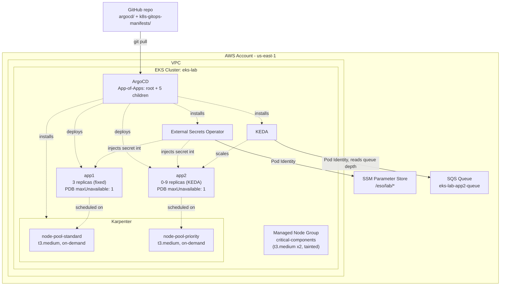

# AWS EKS Autoscaling Lab

A personal, hands-on AWS EKS lab built to go past "click-ops tutorial" level and into the parts that actually break in practice: dual-axis autoscaling (pod-level via KEDA, node-level via Karpenter), GitOps delivery with ArgoCD, least-privilege AWS auth via EKS Pod Identity, cost guardrails, and the debugging that happens when documentation and reality disagree.

Terraform provisions the AWS side, the EKS cluster and ArgoCD itself. From there ArgoCD (App-of-Apps pattern) pulls everything else from this git repo: Karpenter, External Secrets Operator, KEDA and the sample applications. A single `bootstrap.sh` script ties the two phases together.

## Why this exists

Most EKS tutorials stop at "deploy nginx and call it done." This lab intentionally goes further: two isolated node pools with different disruption policies, a workload that scales on a combination of a cron schedule *and* real SQS queue depth, and infrastructure sized specifically so that a pod-scaling event also forces a node-scaling event - so both autoscalers can be watched reacting together, not in isolation. Everything after the cluster itself is delivered through GitOps, with explicit ordering between operators (CRDs) and the resources that depend on them.

## Architecture



Two Karpenter `NodePool`s exist instead of one generic pool, on purpose: `node-pool-standard` (label `standard-node`, taint `standard-taint`) hosts `app1`, and `node-pool-priority` (label `priority-node`, taint `priority-taint`) hosts `app2`. Splitting them means each pool can carry its own disruption/consolidation policy and its own blast-radius budget, and workloads can't accidentally land on the wrong pool.

## Components

| Path | What it is |
|---|---|
| `terraform-eks-infra/` | VPC, EKS cluster, ArgoCD (the only Helm release left in Terraform), Karpenter IAM (Pod Identity), KEDA's IAM role + Pod Identity Association, ESO's IAM role, `app2`'s SQS queue + IAM role |
| `argocd/root.yaml` | The root `Application` (App-of-Apps). The only ArgoCD resource applied by hand/by `bootstrap.sh` |
| `argocd/apps/` | Five child `Application`s: `karpenter-crd`, `external-secrets`, `keda` (sync wave 0), `karpenter` (wave 1), `eks-lab-manifests` (wave 2). Helm values are inlined here |
| `k8s-gitops-manifests/karpenter/` | `EC2NodeClass` + `NodePool` definitions for both pools |
| `k8s-gitops-manifests/eso/` | `ClusterSecretStore` + `ExternalSecret` pulling from SSM Parameter Store |
| `k8s-gitops-manifests/app1/` | Static 3-replica deployment + PDB, consumes the ESO-managed secret |
| `k8s-gitops-manifests/app2/` | KEDA-scaled deployment + `ScaledObject`/`TriggerAuthentication` + PDB |
| `helm/` | Reference Helm values for ESO and Karpenter (the values actually used live inline in `argocd/apps/`) |
| `bootstrap.sh` | End-to-end: `terraform apply`, kubeconfig, then applies the root `Application`; ArgoCD does the rest |

## Key design decisions

- **GitOps with App-of-Apps and sync waves.** One root `Application` points at `argocd/apps/`, and each child carries a `sync-wave` annotation so operators and their CRDs (`karpenter-crd`, `external-secrets`, `keda`: wave 0) are `Healthy` before the controller (`karpenter`: wave 1) and before the custom resources that need those CRDs (`eks-lab-manifests`: wave 2). For the parent to actually wait on a child, ArgoCD needs a custom Lua health check for `Application` objects, which is set in `terraform-eks-infra/argocd.tf`. Inside `eks-lab-manifests` there are further waves (`ClusterSecretStore` before `ExternalSecret` before workloads before `ScaledObject`).
- **ArgoCD is the single owner of cluster add-ons and workloads; Terraform owns AWS and ArgoCD itself.** ArgoCD cannot install itself, so it stays a Terraform `helm_release`. Everything else, including the Helm charts for Karpenter, ESO and KEDA, is an ArgoCD `Application`. IAM roles and Pod Identity Associations stay in Terraform because they are AWS-side resources.
- **EKS Pod Identity over IRSA, everywhere.** ESO, KEDA, Karpenter, and `app2` all authenticate to AWS via Pod Identity Associations instead of IRSA's OIDC-annotation dance - one less moving part, and the pattern that AWS is pushing new workloads toward.
- **Combined Cron + SQS KEDA trigger on `app2`.** A cron trigger guarantees at least 1 replica during "business hours" (08:00-20:00 Europe/Belgrade), while an SQS trigger reacts to actual queue depth on top of that. KEDA combines multiple triggers as OR (max of each trigger's desired replica count), so the two policies layer cleanly instead of fighting each other.
- **`app2` is deliberately sized to co-force Karpenter scaling.** Each pod requests `500m`/`900Mi`, chosen so exactly 3 pods fit on one `t3.medium` (~1930m/~3292Mi allocatable). With `maxReplicaCount: 9`, a full scale-up needs 3 nodes - so sending SQS messages exercises KEDA (pod count) and Karpenter (node count) at the same time instead of one masking the other.
- **PDBs use `maxUnavailable: 1`, not `minAvailable`.** Simpler mental model, but it's a conscious trade-off: when only one replica is up (e.g. `app2`'s cron-guaranteed baseline), `maxUnavailable: 1` still permits evicting that single pod. `minAvailable: 1` would protect it, at the cost of blocking node drains whenever the workload is scaled down. For this lab, simplicity won.
- **Cost guardrails on both NodePools:** hard `cpu`/`memory` limits (~5 nodes worth), on-demand only (no Spot, for predictability over savings), a 14-day forced node expiry, and a scheduled weekly window that blocks empty/underutilized consolidation except for a 2-hour Tuesday-morning gap.
- **Deliberately skipped:** Kustomize (one cluster, little value, and not required by ArgoCD), ArgoCD `AppProject`s (`default` is enough for a single user), ApplicationSets (five different Applications, not one template), and Argo Rollouts on `app1`/`app2` (placeholder pods with no traffic to shift).

## Real-world debugging notes

The most useful part of this repo isn't the happy path - it's what broke and how it got diagnosed:

- **KEDA's `aws-eks` Pod Identity provider is a dead end.** Setting `TriggerAuthentication.spec.podIdentity.provider: aws-eks` (the name that intuitively matches "EKS Pod Identity") instead throws `error parsing SQS queue metadata: awsAccessKeyID not found`. Reading KEDA's own source (`pkg/scalers/aws/aws_common.go`) showed why: only `provider: aws` is wired to the native Pod Identity/IRSA code path - `aws-eks` is a legacy branch that still expects static credentials. Diagnosed by going from operator logs straight to the upstream Go source, not by trial and error.
- **A Pod Identity Association doesn't retroactively fix a running pod.** The KEDA operator pod had been scheduled before Terraform created its `aws_eks_pod_identity_association`, so it never got the AWS credential environment variables the EKS Pod Identity webhook injects at pod *creation* time, and silently fell back to the node's EC2 role (`AccessDenied` on SQS). The cause was a backwards `depends_on` in Terraform. Fixed by ordering: the association is created by `terraform apply`, and KEDA is installed afterwards by ArgoCD, so the ordering now holds by construction. On an already-running pod the workaround is `kubectl rollout restart deployment keda-operator`.
- **ArgoCD `selfHeal` fights autoscalers over `replicas`.** `app2`'s Deployment had `replicas: 1` in git, ArgoCD kept restoring it, and KEDA kept scaling it back to 0, producing a create/run/terminate loop every ~15-60 seconds (visible as repeated `Original Replicas Count: 1 -> New Replicas Count: 0` in the KEDA operator log). Fixed with `ignoreDifferences` on `/spec/replicas` for that Deployment, and by removing the field from the manifest.
- **ESO's CRDs are too big for client-side apply.** Through ArgoCD, the `external-secrets` chart failed with `metadata.annotations: Too long: may not be more than 262144 bytes`. Default client-side apply embeds a full copy of the manifest in the `last-applied-configuration` annotation, even on first create, and the `ClusterSecretStore`/`SecretStore` CRDs exceed Kubernetes' 256KB annotation limit. `helm install` never hit this because Helm tracks releases in its own Secrets. Fixed with `ServerSideApply=true` on that Application. A side effect worth knowing: charts installed through ArgoCD do not show up in `helm list`, since ArgoCD only renders templates and applies the YAML itself.
- **New AWS accounts have a real, low vCPU ceiling.** Testing Karpenter's multi-node scale-out hit the default "Running On-Demand Standard instances" quota of 8 vCPUs - already fully consumed by the existing managed node group + both NodePools' baseline nodes. A quota increase request was submitted and denied ("ramp up usage first, reapply next billing cycle"), and checking the equivalent Spot quota showed the same ceiling. Documented as a known, external limitation rather than papered over.

## Current status

| Area | Status |
|---|---|
| VPC, EKS cluster, IAM | Done |
| Karpenter (2 NodePools, cost guardrails) | Done |
| External Secrets Operator | Done |
| `app1` (static, ESO-backed) | Done |
| `app2` + KEDA (Cron + SQS `ScaledObject`) | Done |
| PodDisruptionBudgets | Done |
| ArgoCD GitOps: App-of-Apps, sync waves, Karpenter + ESO + apps | Done, verified end-to-end on a fresh cluster |
| KEDA installed through ArgoCD (previously a Terraform Helm release) | Written, not yet verified end-to-end |
| Live Karpenter multi-node scaling test | Blocked on AWS account vCPU quota (see above) |
| Kustomize | Deliberately skipped - not a prerequisite for ArgoCD, and low value for a single-cluster lab |
| CI (`terraform fmt`/`validate`, `tflint`, manifest linting) | Planned |

## Running it

Prerequisites: an AWS account, the AWS CLI configured with a profile that has sufficient permissions, Terraform, and `kubectl`. (No local Helm is needed: Terraform's Helm provider and ArgoCD do the chart work.)

ArgoCD reads this repo from GitHub, so changes must be pushed to `main` before they take effect. If you fork it, change `repoURL` in `argocd/root.yaml` and `argocd/apps/eks-lab-manifests.yaml`.

```bash
# bootstrap.sh assumes an AWS CLI profile named "privatni" and absolute paths under /home/nikola/learning -
# change AWS_PROFILE and the paths at the top of the script to match your setup
./bootstrap.sh
```

This runs, in order: `terraform apply` (VPC, EKS, IAM, Pod Identity, ArgoCD), kubeconfig update, a cleanup of any stale Karpenter CRDs, then applies `argocd/root.yaml`. From there ArgoCD creates the child Applications in wave order: `karpenter-crd`, `external-secrets` and `keda`, then `karpenter`, then `eks-lab-manifests` (node pools, ESO config, `app1`, `app2`).

Reach the ArgoCD UI with a port-forward (the service is ClusterIP on purpose, no load balancer cost); details are in `terraform-eks-infra/argocd-access.md`:

```bash
kubectl port-forward svc/argocd-server -n argocd 8080:443
kubectl -n argocd get secret argocd-initial-admin-secret -o jsonpath='{.data.password}' | base64 -d
```

To exercise `app2`'s autoscaling once it's deployed:

```bash
for i in $(seq 1 45); do
  aws sqs send-message \
    --queue-url https://sqs.us-east-1.amazonaws.com/<your-account-id>/eks-lab-app2-queue \
    --message-body "test-$i" --profile <your-profile> --region us-east-1
done
```

Remember to `terraform destroy` when you're done; a running cluster costs roughly $0.30/hour.

## Known limitations

- The `app1`/`app2` containers are placeholder `alpine:latest` (`sleep infinity`) - the point of this lab is the platform plumbing (autoscaling, secrets, IAM, GitOps), not the application logic.
- `k8s-gitops-manifests/app2/scaledobject-app2.yaml` has this lab's AWS account ID baked into the SQS queue URL. That's not a secret (account IDs show up in every ARN and CloudTrail entry regardless), just swap it for your own if you reuse this manifest.
- `bootstrap.sh` has hardcoded absolute paths and an AWS profile name, and the ArgoCD `repoURL` points at the original repo (see "Running it").
- Helm values for Karpenter and ESO exist twice: in `helm/` and inlined in `argocd/apps/`. A remote chart source cannot read a values file from this repo, and only the inlined copy is used.
- The CRD → CR ordering relies on sync waves plus the custom `Application` health check. A failed automated sync is not retried for the same commit, so if something goes wrong on first bootstrap, a manual sync is needed.
- The live "Karpenter scales to 3 nodes" test is code-complete but unverified end-to-end, pending the AWS quota increase described above. KEDA delivered through ArgoCD is likewise not yet verified end-to-end.
