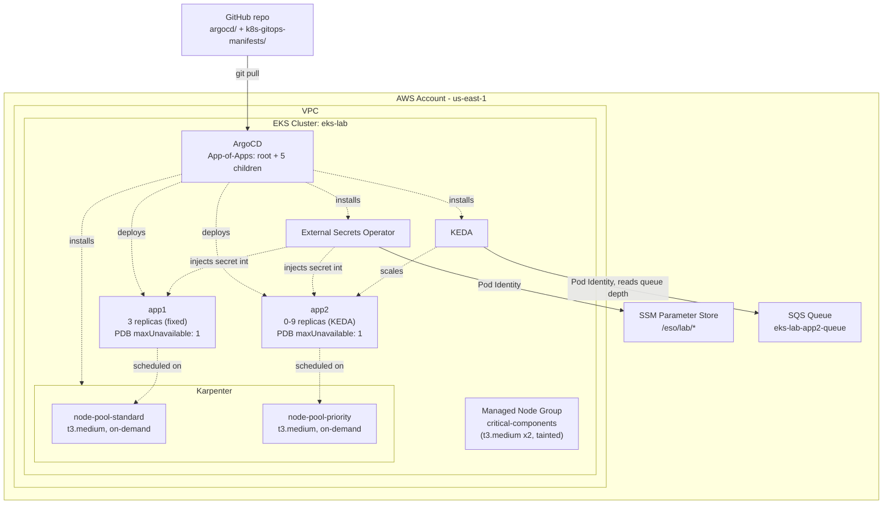
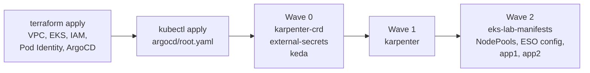

# AWS EKS Autoscaling Lab


[](https://github.com/VlahovicN/eks-terraform-lab/actions/workflows/ci.yaml)

A personal, hands-on AWS EKS lab that goes past the "deploy nginx" tutorial level and into the parts that actually break in practice: dual-axis autoscaling (pods via **KEDA**, nodes via **Karpenter**), GitOps delivery with **ArgoCD**, least-privilege AWS auth with **EKS Pod Identity**, cost guardrails, and the debugging that happens when documentation and reality disagree.

Terraform provisions the AWS side, the EKS cluster and ArgoCD itself. From there ArgoCD (App-of-Apps pattern) pulls everything else from this repo: Karpenter, External Secrets Operator, KEDA and the sample applications. A single `bootstrap.sh` ties the two phases together.

## Highlights

- **Fully GitOps after the first command.** One root ArgoCD `Application` fans out into five child Applications, ordered with sync waves so CRDs always exist before the resources that need them.
- **Two autoscalers, watched together.** `app2` scales 0 to 9 pods on a Cron + SQS trigger and is sized so a full scale-up forces Karpenter to add nodes at the same time.
- **EKS Pod Identity everywhere** (ESO, KEDA, Karpenter, `app2`), with no IRSA OIDC annotations.
- **Cost guardrails by design:** hard NodePool limits, on-demand only, 14-day node expiry, a scheduled consolidation window, and a public-subnet VPC with no NAT gateway.
- **Documented failures.** Every real bug hit while building this (and its root cause) is written up in [Real-world debugging notes](#real-world-debugging-notes).
- **Verified on a fresh cluster**, not just on paper. See [Verified results](#verified-results).

## Architecture



Two Karpenter `NodePool`s exist instead of one generic pool, on purpose: `node-pool-standard` (label `standard-node`, taint `standard-taint`) hosts `app1`, and `node-pool-priority` (label `priority-node`, taint `priority-taint`) hosts `app2`. Splitting them means each pool carries its own disruption policy and blast-radius budget, and workloads cannot land on the wrong pool by accident.

### Bootstrap order



Inside `eks-lab-manifests` there are further waves: `ClusterSecretStore` and `EC2NodeClass`, then `ExternalSecret` and `NodePool`, then the workloads and PDBs, and finally the `ScaledObject`.

## Components

| Path | What it is |
|---|---|
| `terraform-eks-infra/` | VPC, EKS cluster, ArgoCD (the only Helm release left in Terraform), Karpenter IAM (Pod Identity), KEDA's IAM role + Pod Identity Association, ESO's IAM role, `app2`'s SQS queue + IAM role |
| `argocd/root.yaml` | The root `Application` (App-of-Apps). The only ArgoCD resource applied by hand / by `bootstrap.sh` |
| `argocd/apps/` | Five child `Application`s: `karpenter-crd`, `external-secrets`, `keda` (sync wave 0), `karpenter` (wave 1), `eks-lab-manifests` (wave 2). Helm values are inlined here |
| `k8s-gitops-manifests/karpenter/` | `EC2NodeClass` + `NodePool` definitions for both pools |
| `k8s-gitops-manifests/eso/` | `ClusterSecretStore` + `ExternalSecret` pulling from SSM Parameter Store |
| `k8s-gitops-manifests/app1/` | Static 3-replica deployment + PDB, consumes the ESO-managed secret |
| `k8s-gitops-manifests/app2/` | KEDA-scaled deployment + `ScaledObject`/`TriggerAuthentication` + PDB |
| `bootstrap.sh` | End-to-end: `terraform apply`, kubeconfig, then applies the root `Application`; ArgoCD does the rest |

## Key design decisions

- **GitOps with App-of-Apps and sync waves.** One root `Application` points at `argocd/apps/`, and each child carries a `sync-wave` annotation so operators and their CRDs (`karpenter-crd`, `external-secrets`, `keda`: wave 0) are `Healthy` before the controller (`karpenter`: wave 1) and before the custom resources that need those CRDs (`eks-lab-manifests`: wave 2). For the parent to actually wait on a child, ArgoCD needs a custom Lua health check for `Application` objects, set in `terraform-eks-infra/argocd.tf`.
- **ArgoCD owns cluster add-ons and workloads; Terraform owns AWS and ArgoCD itself.** ArgoCD cannot install itself, so it stays a Terraform `helm_release`. Everything else, including the Helm charts for Karpenter, ESO and KEDA, is an ArgoCD `Application`. IAM roles and Pod Identity Associations stay in Terraform because they are AWS-side resources. This split also fixes an ordering problem structurally: Terraform (including the Pod Identity Association) always finishes before ArgoCD installs the operator that needs it.
- **EKS Pod Identity over IRSA, everywhere.** ESO, KEDA, Karpenter and `app2` all authenticate to AWS through Pod Identity Associations instead of IRSA's OIDC-annotation setup: one less moving part, and the pattern AWS is steering new workloads toward.
- **Combined Cron + SQS KEDA trigger on `app2`.** A cron trigger guarantees at least 1 replica during business hours (08:00-20:00 Europe/Belgrade), while an SQS trigger reacts to actual queue depth on top of that. KEDA combines multiple triggers as OR (the max of each trigger's desired replica count), so the two policies layer instead of fighting each other. Outside that window with an empty queue, `app2` correctly sits at 0 replicas.
- **`app2` is deliberately sized to co-force Karpenter scaling.** Each pod requests `500m`/`900Mi`, chosen so exactly 3 pods fit on one `t3.medium` (~1930m/~3292Mi allocatable). With `maxReplicaCount: 9`, a full scale-up needs 3 nodes, so sending SQS messages exercises KEDA (pod count) and Karpenter (node count) at the same time instead of one masking the other.
- **PDBs use `maxUnavailable: 1`, not `minAvailable`.** Simpler mental model, but a conscious trade-off: when only one replica is up (e.g. `app2`'s cron-guaranteed baseline), `maxUnavailable: 1` still permits evicting that single pod. `minAvailable: 1` would protect it, at the cost of blocking node drains whenever the workload is scaled down. For this lab, simplicity won.
- **Cost guardrails on both NodePools:** hard `cpu`/`memory` limits (~5 nodes worth), on-demand only (predictability over Spot savings), a 14-day forced node expiry, and a scheduled weekly window that blocks empty-node consolidation and drift replacement (e.g. a new AMI) except for a 2-hour Tuesday-morning gap. The VPC uses public subnets and no NAT gateway to avoid its hourly and data costs.
- **`terraform.tfvars` is committed on purpose.** It contains a single value (`kubernetes_version`) and nothing sensitive, so it stays in the repo as a visible, reproducible input. State files, `.terraform/` and local notes are gitignored.
- **Deliberately skipped:** Kustomize (one cluster, little value, and not required by ArgoCD), ArgoCD `AppProject`s (`default` is enough for a single user), ApplicationSets (five different Applications, not one template), and Argo Rollouts on `app1`/`app2` (placeholder pods with no traffic to shift).

## Verified results

The ArgoCD UI after a fresh `bootstrap.sh`: the `root` Application and its five children, all `Synced` and `Healthy`.


The same state from the command line, captured on a freshly bootstrapped cluster:

```text
$ kubectl get application -n argocd
NAME                SYNC STATUS   HEALTH STATUS
eks-lab-manifests   Synced        Healthy
external-secrets    Synced        Healthy
karpenter           Synced        Healthy
karpenter-crd       Synced        Healthy
keda                Synced        Healthy
root                Synced        Healthy

$ kubectl get scaledobject
NAME                SCALETARGETNAME   MIN   MAX   READY   ACTIVE   TRIGGERS             AUTHENTICATIONS
app2-scaledobject   app2-sqs-test     0     9     True    False    cron,aws-sqs-queue   app2-sqs-trigger-auth

$ kubectl get nodeclaims
NAME                       TYPE        CAPACITY    ZONE         READY
node-pool-priority-54ksk   t3.medium   on-demand   us-east-1b   True
node-pool-standard-jj8jf   t3.medium   on-demand   us-east-1b   True
```

What this confirms:

- The root plus all five children converge to `Synced`/`Healthy` with no manual steps, in wave order.
- `keda-operator` carries the Pod Identity credential variables (`AWS_CONTAINER_CREDENTIALS_FULL_URI`, `AWS_CONTAINER_AUTHORIZATION_TOKEN_FILE`) with no restart workaround, which proves the Terraform-then-ArgoCD ordering.
- `app1` runs 3/3 on a Karpenter-provisioned node. `app2` sits at 0 replicas with the `ScaledObject` `Ready=True, Active=False` outside the cron window and with an empty queue, as designed.
- Karpenter provisioned one node per pool in response to pending pods, with no manual action.

## Real-world debugging notes

The most useful part of this repo isn't the happy path, it's what broke and how it got diagnosed:

- **KEDA's `aws-eks` Pod Identity provider is a dead end.** Setting `TriggerAuthentication.spec.podIdentity.provider: aws-eks` (the name that intuitively matches "EKS Pod Identity") instead throws `error parsing SQS queue metadata: awsAccessKeyID not found`. Reading KEDA's own source (`pkg/scalers/aws/aws_common.go`) showed why: only `provider: aws` is wired to the native Pod Identity/IRSA code path, while `aws-eks` is a legacy branch that still expects static credentials.
- **A Pod Identity Association doesn't retroactively fix a running pod.** The KEDA operator pod had been scheduled before Terraform created its `aws_eks_pod_identity_association`, so it never got the AWS credential environment variables the EKS Pod Identity webhook injects at pod *creation* time, and silently fell back to the node's EC2 role (`AccessDenied` on SQS). The cause was a backwards `depends_on` in Terraform. Fixed by ordering: the association is created by `terraform apply`, and KEDA is installed afterwards by ArgoCD, so the ordering holds by construction. On an already-running pod the workaround is `kubectl rollout restart deployment keda-operator`.
- **ArgoCD `selfHeal` fights autoscalers over `replicas`.** `app2`'s Deployment had `replicas: 1` in git, ArgoCD kept restoring it, and KEDA kept scaling it back to 0, producing a create/run/terminate loop every ~15-60 seconds (visible as repeated `Original Replicas Count: 1 -> New Replicas Count: 0` in the KEDA operator log). Fixed with `ignoreDifferences` on `/spec/replicas` for that Deployment, and by removing the field from the manifest.
- **ESO's CRDs are too big for client-side apply.** Through ArgoCD, the `external-secrets` chart failed with `metadata.annotations: Too long: may not be more than 262144 bytes`. Default client-side apply embeds a full copy of the manifest in the `last-applied-configuration` annotation, even on first create, and the `ClusterSecretStore`/`SecretStore` CRDs exceed Kubernetes' 256KB annotation limit. `helm install` never hit this because Helm tracks releases in its own Secrets. Fixed with `ServerSideApply=true` on that Application. A side effect worth knowing: charts installed through ArgoCD do not show up in `helm list`, since ArgoCD only renders templates and applies the YAML itself.
- **ArgoCD can only sync what is in git.** After moving KEDA from Terraform to an ArgoCD `Application`, the cluster came up with no KEDA pods and no app pods. The new `keda.yaml` existed only locally: the root app was still reading the old commit from GitHub, so the `keda` Application was never created, its CRDs never existed, and `eks-lab-manifests` stayed `Missing` with `failed to discover server resources for group version keda.sh/v1alpha1`. Fix: push, then force the root app to re-read git instead of waiting for the ~3 minute poll (`kubectl annotate application root -n argocd argocd.argoproj.io/refresh=hard --overwrite`).
- **"No pods" is not always a failure.** With `minReplicaCount: 0`, `app2` correctly has zero pods when the queue is empty and the cron window is closed. A health check that waits for N running pods will wait forever, so check `ScaledObject` `Ready`/`Active` first.
- **New AWS accounts have a real, low vCPU ceiling.** Testing Karpenter's multi-node scale-out hit the default "Running On-Demand Standard instances" quota of 8 vCPUs, already consumed by the managed node group plus both NodePools' baseline nodes. A quota increase request was submitted and denied ("ramp up usage first, reapply next billing cycle"), and the equivalent Spot quota showed the same ceiling. Documented as a known external limitation rather than papered over.

## Current status

| Area | Status |
|---|---|
| VPC, EKS cluster, IAM | Done |
| Karpenter (2 NodePools, cost guardrails) | Done |
| External Secrets Operator | Done |
| `app1` (static, ESO-backed) | Done |
| `app2` + KEDA (Cron + SQS `ScaledObject`) | Done |
| PodDisruptionBudgets | Done |
| ArgoCD GitOps: App-of-Apps, sync waves, Karpenter + ESO + KEDA + apps | Done, verified end-to-end on a fresh cluster |
| Live Karpenter multi-node scaling test (SQS burst to 9 pods, 3 nodes) | Blocked on AWS account vCPU quota (see above) |
| Kustomize | Deliberately skipped, not a prerequisite for ArgoCD and low value for a single-cluster lab |
| CI (`terraform fmt`/`validate`, `tflint`, `yamllint`, `kubeconform`) | Done, runs on every push (GitHub Actions) |

## Running it

Prerequisites: an AWS account, the AWS CLI configured with a profile that has sufficient permissions, Terraform, and `kubectl`. No local Helm is needed: Terraform's Helm provider and ArgoCD do the chart work.

ArgoCD reads this repo from GitHub, so **changes must be pushed to `main` before they take effect**. If you fork it, change `repoURL` in `argocd/root.yaml` and `argocd/apps/eks-lab-manifests.yaml`.

```bash
# bootstrap.sh assumes an AWS CLI profile named "privatni" and absolute paths under /home/nikola/learning,
# change AWS_PROFILE and the paths at the top of the script to match your setup
./bootstrap.sh
```

This runs, in order: `terraform apply` (VPC, EKS, IAM, Pod Identity, ArgoCD), kubeconfig update, a cleanup of any stale Karpenter CRDs, then applies `argocd/root.yaml`. From there ArgoCD creates the child Applications in wave order: `karpenter-crd`, `external-secrets` and `keda`, then `karpenter`, then `eks-lab-manifests` (node pools, ESO config, `app1`, `app2`). Expect `app1`/`app2` to sit `Pending` for a minute or two while Karpenter launches the first nodes.

Reach the ArgoCD UI with a port-forward (the service is ClusterIP on purpose, so there is no load balancer cost); details are in `terraform-eks-infra/argocd-access.md`:

```bash
kubectl port-forward svc/argocd-server -n argocd 8080:443
kubectl -n argocd get secret argocd-initial-admin-secret -o jsonpath='{.data.password}' | base64 -d
```

To exercise `app2`'s autoscaling once it's deployed:

```bash
for i in $(seq 1 45); do
  aws sqs send-message \
    --queue-url https://sqs.us-east-1.amazonaws.com/<your-account-id>/eks-lab-app2-queue \
    --message-body "test-$i" --profile <your-profile> --region us-east-1
done
```

### Cost and cleanup

A running cluster costs roughly **$0.30/hour** (EKS control plane, four `t3.medium` nodes, public IPv4 addresses, EBS). Tear it down when you're done:

```bash
terraform -chdir=terraform-eks-infra destroy
```

## Known limitations

- The `app1`/`app2` containers are placeholder `alpine:latest` (`sleep infinity`). The point of this lab is the platform plumbing (autoscaling, secrets, IAM, GitOps), not application logic.
- `k8s-gitops-manifests/app2/scaledobject-app2.yaml` has this lab's AWS account ID baked into the SQS queue URL. That's not a secret (account IDs show up in every ARN and CloudTrail entry regardless), just swap it for your own if you reuse this manifest.
- `bootstrap.sh` has hardcoded absolute paths and an AWS profile name, and the ArgoCD `repoURL` points at the original repo (see "Running it").
- The CRD-before-CR ordering relies on sync waves plus the custom `Application` health check. A failed automated sync is not retried for the same commit, so if something goes wrong on first bootstrap, a manual sync is needed.
- The live "Karpenter scales to 3 nodes" test is code-complete but unverified end-to-end, pending the AWS quota increase described above.

## How this was built

Built as a learning project with AI assistance (Claude Code) for debugging and documentation; everything was run against a real EKS cluster.

## License

Released under the [MIT License](LICENSE).
